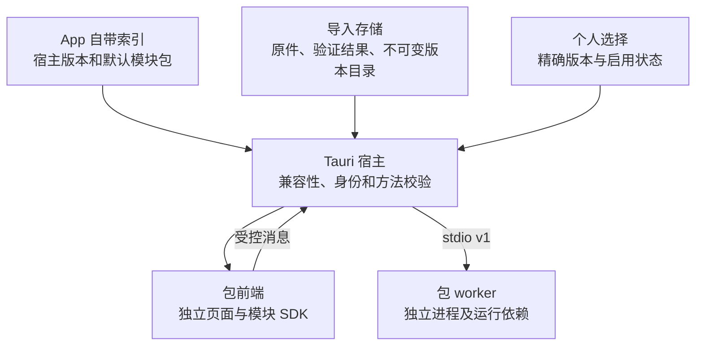

# OpenDesk 架构与边界

本文包含用户授权的本地版本化页签包。实现范围与运行证据分开，具体检查结果见 README 和验证记录。

当前正式交付为 [App 0.19.3](https://github.com/utxnimda/OpenDesk/releases/tag/v0.19.3)、[塔防助手 0.9.3](https://github.com/utxnimda/OpenDesk/releases/tag/modules%2Ftower-assistant%2Fv0.9.3) 和 [AI 工作台 0.4.4](https://github.com/utxnimda/OpenDesk/releases/tag/modules%2Fai-workbench%2Fv0.4.4)，来源为干净提交 `92c22f21d21f5287e8acb515d1de4509ed1bec50`。App 只随附塔防，独立塔防包与随附包字节一致，AI 独立下载导入。2026-10-29 三个 Release 的 14 个附件均已重新下载并核对 SHA-256。作品管理器 0.3.1 沿用既有独立 Release；测试包、部署工作台与本机数据未进入本次交付。历史 0.18.0／0.8.2 的来源与验证记录保留。

OpenDesk 的应用标识为 `net.nimda.opendesk`。可执行文件、worker、构建目录及环境变量使用 OpenDesk / opendesk / OPENDESK 命名。默认配置与包选择归属该应用的数据目录，不自动迁入或删除旧应用数据；版本历史和历史验证记录保留原始身份及证据含义。

## 三层责任

| 层 | 责任 |
|---|---|
| Vue / TypeScript 宿主 | 工作区、分类设置、风格配色预览、通用宠物渲染、包列表、版本选择、错误展示、包页面容器 |
| Tauri / Rust 宿主 | 桌面与宠物窗口生命周期、设置存储、包校验/安装/选择、受控资源访问、命令边界和 worker 所有权 |
| 模块包 | 自己的独立前端、业务方法、可选 worker 与运行依赖 |

框架不能导入具体业务；构建组合选择源码模块并产出包，运行组合由已验证清单和宿主选择决定。塔防算法保留在原模块中，框架只管理其包及生命周期。

宿主 Vite 根入口为 `apps/composition/frontend`。组合层选择主界面、宠物、宠物菜单或通用模块第二视图；宠物目录仍通过 `CompanionCatalog` 注入。宿主 0.18.0 / `core.module-packages` 0.7.0 当时新增 `module-surface` 窗口，塔防 0.7.0 首先使用这一通用契约，通用原生链路已验证，实际游戏视觉仍待验收。已公开的 0.15.0（core.companion 0.6.0、core.workbench 0.8.0）新增薄荷奶油风格与共享宠物菜单面板；既有媒体，包括 0.13.1 的透明思考 WebM，摘要保持不变。框架只认识媒体与交互契约，不导入角色目录。0.15.0 已于 2026-10-23 发布并完成远端附件核验，0.12.0 保留为历史；历史媒体结果与当前类型、自动化、构建、运行证据分别记录。

## 版本事实与加载

`config/version.json` 保留宿主/core 与已有发布历史；包内 `manifest.json` 描述独立模块版本；App 索引说明本次默认随附内容；本机选择及成功激活状态说明用户实际使用版本。旧中央业务历史不能冒充当前包版本。

正式分发范围由 `config/distribution.json` 的 `bundledModules` / `publicModules` 决定：默认随附仍只有 `tower-assistant`，允许独立发布的源码另含 `nimda-workspace`（作品管理器，见 [统一工程说明](media-manager.md)）与 `ai-workbench`（见 [AI 工作台](ai-workbench.md)）。当前公开的 0.19.3 App 随附塔防助手 0.9.3；AI 0.4.4 独立发布，作品管理器 0.3.1 保留原包。历史 0.18.0／0.8.2、0.17.0／0.1.9、0.12.0／0.1.7 的随附事实保留。测试台本地开发版本为 1.0.7，`test-lab` 是开发测试源码，生成包只用于本地 fixture，不进入 App 或独立 Release。本机部署工作台及其他导入包没有进入此次公开交付。运行时导入目录、已安装包和构建缓存都不能决定公开清单。源码归属、构建产物和发布范围分别检查。

模块前端由自己的 `frontend/index.html` 启动，使用相对路径资源。通过 `apps/framework/module-sdk` 的 `createModuleBridge()` 完成身份握手后访问 `bridge.host`。页面不直接导入 Tauri API，宿主核对当前包及其 manifest 业务方法。旧页面的消息不能被当作新版本结果。

每个带后台的包携带 `worker/module-worker.exe` 和 `_internal`。宿主只启动当前启用包的明确入口，不依赖源码目录、系统 Python 或任意用户执行路径。worker 身份通过构建时烘焙的 `module.identity` 确认；它与 `runtime.*` 都是管理协议，不列入业务 methods。

独立目录、消息来源校验和独立进程不是安全沙箱；本地代码包仍需来自用户信任的来源。框架不宣称任意恶意代码都被隔离。

## 导入和切换

导入先保存原件，再校验结构、身份、版本、API、平台、入口和数据 schema。失败项保留原件及错误，不执行代码或覆盖可用版本。

同 ID/版本/摘要是重复内容；同 ID/版本异摘要是冲突。同页签多个版本可以安装，只有当前启用版本运行。选择与激活成功分别表达，失败不能显示为切换成功。App 升级不能静默覆盖用户个人选择。

从新 App 随附清单中排除测试台不等于卸载用户先前导入的测试台。既有本机选择和导入数据继续独立保存，不复制到公开产物，也不因本次分发调整被自动删除。

## 状态、数据与生命周期

Rust 是框架设置和包选择的单一权威；前端缓存不是第二写入者。自带资源、导入原件、版本目录和业务数据分离。路径由宿主明确解析，不依赖启动 cwd。

0.15.0 的宠物偏好命令同时负责原生窗口显示、隐藏与尺寸效果。前端设置通知和可见性通知只刷新镜像与渲染，不依据可能过期的设置再次发送原生 hide/show；主界面仅在初始读取、显式重试或资源目录变动时协调窗口。设置读取按请求代次过滤，避免快速切换模式后迟到响应关闭新菜单。

设置仍为 schema 1，`uiStyle` 与宠物配置缺失时补充默认值；旧宠物配置缺少 `actionMode` 时默认为 `idle`，`animated` 是唯一持久化播放开关。旧 `personalization.background` / `effects` 只作为兼容输入忽略，不参与渲染或执行；旧图片不读取、不删除。其他未知字段、无效枚举与宠物参数越界仍拒绝。前端维护可回滚的风格和配色草稿，浏览器预览只在当前会话生效。桌面宠物窗口使用已保存的设置，不能因为预览而绕过 Rust 的启用/模式检查。

主界面 `selectCompanion` 专门选择或停用角色，立即返回保存后的权威设置；选择同一角色也执行召回。`saveAppearance` 只保存 `theme`、`uiStyle` 和 `closeToTray`。宠物菜单通过 `updateCompanion` 提交有界的单项偏好变更，由 Rust 基于最新设置局部合并、验证并持久化，避免主窗口与宠物窗口以旧快照覆盖彼此。设置页收到新设置时以旧属性快照、当前草稿和新属性做三方合并，保留未保存的外观字段，宠物状态总是采用最新值。失败显式返回，不能先更新显示再伪装已经保存。

代码版本与数据 schema 独立。当前不兼容数据 schema 直接拒绝，不提供静默迁移、快照恢复或覆盖式回退。选择旧代码不能删除升级后产生的新数据。塔防的存档/规划视图仍只读游戏文件；0.8.2 正式版本保留此前 0.6.1 的显式采集安装/恢复操作，在确认游戏关闭且版本已核验后备份并修改 `package.nw`。恢复只接受安装时记录的包与备份摘要，游戏更新后拒绝覆盖。安装检查独立报告 `updateRequired`，导入新页签不改写游戏中的旧入口，需用户退出游戏后移除恢复、重新安装并重启。测试模块只回显消息，不引入业务数据库。

塔防采集、公式计算和计时累计归模块 Python worker 所有，固定原创脚本只观察已核实的游戏消费边界，经游戏目录内带身份令牌的有界事件文件交给 worker；不开放网络监听或任意脚本入口。观察器保存原游戏公式调用的输入和结果，不为采集再次求值；Python 按原顺序复算工作和伤害公式。后台在统计运行期间每 200 ms 读取，前端每秒串行请求展示快照；业务视图卸载只停止自身刷新，主包实例及 worker 的终止由宿主管理。worker 持有人物、工作类型、伤害类型及攻击类别的有界累计，另保留滚动明细和每组最近事件快照；历史公式请求严格核对会话与序号；0.8.1 为已显示事件附带原样 JSON 载荷和实例级 HMAC 校验，后台校验后复算原事件，即使滚动缓存已淘汰。前端只缓存载荷，不拥有公式算法；快照读取不切换当前目录或改写累计，worker 退出或目录实例释放后不能继续补取。汇总格按会话和分组原子读取最近事件，再固定返回的实际序号与公式。前端固定详情是选中时的独立只读副本，不随轮询、明细淘汰或新会话消失；暂停显示也只冻结列表。人物信息来自实际事件快照，不以存档详情代替实时资料。安装备份与流文件属于游戏目录的本机数据，累计结果在 worker 内存中，均不进入模块包或源码 Git。框架转发 manifest 声明的方法与管理自己拥有的 worker，不接管业务累计；发布版本不代表真实游戏运行或本机激活已经验证。宿主 0.18.0、塔防 0.7.0 与 0.7.1 的既有验收结果保留；0.8.0 布局与 0.8.1 历史公式修复的既有验证分别保留，0.8.2 的正式干净构建、冻结 worker 和产物检查已通过；这些检查均不能代替真实游戏叠加验收。

宿主只清理自己拥有的进程。失败、退出和超时不能当作成功；长任务、任意热卸载和任务恢复不因包机制而自动具备。WebView2 自己的缓存也不等于框架设置根。

## 模块第二视图与窗口所有权

0.18.0 通过 SDK 可选 `LimitedHost.surface` 提供 `open(options)`、`close()`、`setAlwaysOnTop(enabled)` 与 `startDrag()`。连接消息的可选 `moduleSurface` 描述本次视图：主页面的 `surface.context` 为 `null`，第二视图为 `{view, data}`。旧宿主不发送这一扩展，新 SDK 的 `host.surface` 保持 `undefined`；业务页签须提示能力不可用，其余 `hostApi: 1` 方法保持兼容。

`PackageFrame` 只允许主页面申请第二视图；Rust 从已完成身份确认的当前包实例取得入口和绑定 token，创建同一 App 拥有的透明、无装饰 `module-surface` 原生窗口。`ModuleSurfaceApp` 作为通用 iframe 容器重新加载该包的前端，由包根据上下文选择业务视图。框架不导入塔防组件，不接受模块提供的任意 URL、HTML、shell 或窗口句柄。请求仅携带有界的视图名、标题、尺寸、置顶状态和 JSON 上下文。

第二视图借用主页面的同一 worker，不调用包打开、激活、恢复或停止接口；关闭第二视图仅销毁窗口，因此不会清空其业务计时。主模块关闭、停用或切换包时撤销绑定并关闭第二视图。当前宿主同时维护一个第二视图；重复打开相同绑定与参数会聚焦原窗口，改变绑定或参数会替换视图。Rust 校验原生窗口身份、当前 generation 与包 token，iframe 桥接同时校验来源、编译身份和 generation；迟到请求不得控制替代窗口或其他模块。

原生窗口可置顶、拖动和调整大小，尺寸与位置受显示器可用区域约束，不提供鼠标穿透。排名、筛选、背景不透明度和人物快照属于模块展示层；累计与计时继续以 worker 返回快照为准。塔防 0.8.0 在模块内部共享多榜投影逻辑，按已选工作、伤害属性或职业从累计快照派生榜单，不从滚动明细重算历史。打开上下文可携带模块自有筛选，模块两端严格校验，宿主仍只处理通用有界 JSON，不理解具体筛选字段。通用原生链路已验证，App 0.18.0 与塔防 0.8.2 已分别发布；新业务布局在实际游戏上的视觉效果仍待验收，发布不改变个人选择。

## 静态风格与旧配置边界

OpenDesk 0.9.0 移除背景导入、背景显示、粒子和氛围调节，设置只保留风格与配色、宠物陪伴、窗口行为。`--import-wallpaper` 被明确拒绝。`core.personalization` 的历史 ID 与 0.8.0 验证记录继续保留；新版本将该能力标为已移除，不能从历史记录推断它仍可用。

既有六种风格保留，新增 `mint`“薄荷奶油”，建议浅色，以静态浅粉/薄荷渐变、深青文字、圆角卡片、中心内容列与轻导航呈现；选择风格不改主题，深色与石墨夜保留各自语义色。`glass` 仍显示为“深海透明”，采用深蓝黑半透明、青色细边、低圆角紧凑分区和顶部标签栏。`surfaceEffects` 继续作为 protocol 1 的可选兼容字段，当前宿主仅按风格生成固定材质与透明度描述，关闭表面动效；没有用户背景图片、材质、浓度或氛围设置。消息不含图片 ID、路径、data URL 或图片字节。

七种风格由 `SUPPORTED_UI_STYLES` 与显式 preset 管理。薄荷布局和公共控件样式放在既有 `workbench-styles.css`，随模块构建指纹变化，因此正式塔防使用新包版本 0.1.9，不覆盖公开 0.1.7。App 升级仍保留用户固定选择，模块内部采用新风格需要手动选中已安装的 0.1.9 或兼容新版本（当前为 0.9.3）。旧 SDK 可忽略或回退未知风格，协议与基础 theme 契约不变。

模块 iframe 固定填满主内容区的剩余空间，内部 body 自行滚动；宿主不测量业务 DOM。设置变化不改变模块身份、版本选择或业务数据。

宿主文档抑制主界面空白区域的浏览器默认右键菜单，输入、可编辑区域与选中文字保留标准菜单；宠物使用自己的交互菜单。模块 iframe 仍管理内部菜单，不受宿主这条规则改写，也不涉及系统或其他应用。

## 宠物窗口与所有权

OpenDesk 0.11.0 的两只角色来自用户第一段和第三段全身视频。阿宝保留 97 帧、24 FPS、约 4.041667 秒的完整站立—跑步—站立；阿沐默认取源帧 51–130（含）形成 80 帧、24 FPS、约 3.333333 秒循环，完整 145 帧、约 6.041667 秒另存于本机 `dist/companion-assets/amu-01/full-cycle.png`，不作为运行时重复资源。近景视频 (2) 弃用。框架保留空目录和缺失模型的显示守卫。

模型契约要求稳定 ID、名称与说明，`still` / `idle` 为必需基础资源；`walk` / `wave` / `sleep` 以及 `thinking` 仅在独立素材实际存在时提供入口。动作元数据显式区分图片与视频媒体并声明主点击动作，不按文件名猜测行为。菜单动作模式只列出实际资源，所选模式持续循环；主点击动作临时覆盖，结束后返回当前所选模式。思考视频以实际媒体结束事件完成或开始下一轮，不能用固定时长截断。阿宝与阿沐既有素材不替换。

应用内组件在当前会话中管理拖动位置；桌面模式使用同一 Tauri 进程拥有的 `companion` WebView 窗口。窗口透明、无装饰、不占任务栏且不可直接拉伸，按保存的角色大小配置尺寸；是否置顶由设置决定。透明矩形不提供按像素自动鼠标穿透保证。

App 设置只显示角色卡和「不启用宠物」，不复制宠物菜单。角色选择立即保存，点击当前角色或托盘「显示宠物」可召回。右键菜单提供播放/暂停、桌面/应用内位置、动作模式、96/128/160/200/256 px 大小、桌面模式的始终置顶、暂时收起与打开主界面。0.15.0 用 `CompanionMenuPanel` 统一头像、状态、分组、分段选择、大小按钮、置顶开关与底部操作；应用内为 DOM 面板，浏览器仅修改预览状态，不具备桌面窗口与托盘能力。

桌面菜单由同一 App 进程拥有的独立透明 `companion-menu` WebView 承载，基准尺寸 320×480，并按显示器可用区域限制尺寸与位置，避免由宠物窗口大小裁切菜单。失焦、Escape 或上下文失效关闭面板。菜单打开上下文带代次，设置更新和隐藏等命令在 Rust 边界核对代次与当前角色，拒绝旧菜单的迟到写入；前端也丢弃过期响应。0.14.0 使用 Tauri 系统原生菜单的历史结果保留原义，不能用来证明这一新窗口与面板已验收。

宠物与菜单窗口分别使用限定 capability。宠物窗口保留自身就绪、状态、拖动、隐藏与受控菜单入口；菜单仅获得必要的设置/宠物上下文读取、单字段偏好更新、隐藏宠物、打开主界面、关闭自身、就绪报告及状态事件。两者都没有角色选择、完整 settings-save 或 appearance-save 权限，也没有任意 shell、文件读写或业务 worker 能力。枚举、参数、窗口来源与菜单代次仍由宿主执行边界校验。关闭宠物窗口转为隐藏，动画随隐藏暂停；主窗口收起到托盘时宠物可继续显示，整个 App 退出时相关窗口一并销毁，没有另一个常驻宠物进程。App 继续拥有宠物生命周期。

普通启动保留单实例约束，即使指定数据根也不会绕过；回调只唤起已有窗口，不处理 `--enable-companion`。使用该启用宠物选项前需退出已有实例；普通用户从资源管理器双击 `OpenDesk.exe` 启动。

`--smoke-test`、`--module-smoke`、`--companion-smoke` 仅在显式提供绝对 `OPENDESK_DATA_DIR` 时跳过单实例，允许与用户实例并存。变量缺失、空值、相对路径或重复/混用 smoke 模式时，启动阶段退出 2；调用方仍负责选择不与用户数据重叠的测试目录。WebView2 缓存仍使用默认应用缓存位置，不因此获得完整浏览器隔离。

`--companion-smoke` 使用真实设置、所选角色图片就绪与窗口事件，写入 `companion-smoke-result.json` 后退出；无资源或模型不存在时不能换用其他形象冒充成功。两个循环均采用原视频连续完整帧，未 AI 重画、插帧或变速；短循环默认选择可逆，不宣称严格无缝。来源与产物参数在各自的 `SOURCES.md` / `provenance.json` 记录。既有默认素材在 0.12.0 交付时已按用户 2026-10-22 的请求纳入公开范围；该历史授权不自动覆盖本次新动作；2026-10-23 用户另行明确授权执行包含已审阅运行资源的当前发布流程。原视频仍不上传，不虚构第三方许可证。

## 动作模式、主点击与加载生命周期

本地 0.13.1 已将 `thinking` 从 0.13.0 的整幅房间 MP4 修正为 alpha VP9 WebM。前景保留阿沐、显示器、键盘与桌椅，房间及物体间背景空隙透明；保留原有半身，不补身体。固定裁取源区域 `[0,167,720,1280]`，缩放为 453×700、置于 768×768 画布 `(157,34)`；全部 145 帧、24 FPS，容器时长 6.042 秒。透明 APNG 母版单独导出，播放一次，不进入运行时。

0.14.0 以持久化 `actionMode` 决定持续动作：图片动作按其素材循环，思考视频在 `ended` 后开始下一轮。角色 `primaryAction` 是临时单次动作，完成后返回当前所选模式，所选模式也可能是思考。视频以 `loadeddata` 报告就绪，以 `ended` 作为正常完成依据；6042 ms 是媒体时长描述，不是完成计时器。每次主点击重触发创建新的播放代次和视频实例，从时间 0 播放。暂停、隐藏、减少动效、模型切换与卸载取消当前播放，旧媒体事件必须与当前代次匹配，不能提前结束新动作。

组合根的 `assets.thinking` 已指向正式 `thinking.webm`，保留 `actionMediaTypes.thinking: "video"`、`actionDurationsMs.thinking: 6042` 与 `primaryAction: "thinking"`。时长字段只参与契约校验，完成由 `ended` 决定。透明来自媒体实际 alpha，不通过假棋盘或降低整个矩形透明度模拟；阿宝和阿沐既有循环/静态图未改。

0.13.1 的正式素材强制 VP9 解码检查覆盖全部 145 帧：alpha 0 与 255 区域保持，中间 alpha 与母版最大差为 1；这不是 RGBA 无损声明。首帧生成 alpha 仅作轮廓参考，前景颜色基于原视频，VP9/YUV420 色彩转换仍可能造成颜色差异。当时完成真实 WebM 在 Chrome 三种底色中的透明与播放检查，以及 Tauri/NSIS、本地核心 smoke 和正常启动，但原生新动作点击和透明视觉未测。0.13.0、0.13.1 与 0.14.0 历史记录不改写，也不能代替当前 0.15.0 风格及菜单窗口验收；具体状态见 [验证记录](verification.md)。用户随后于 2026-10-23 明确要求提交当前代码及资源、完善发布文档并执行发布；提交、推送与 Release 的实际结果仍分别记录。

## 构建与扩展

`scripts/module-pack.mjs` 负责独立 Vite 构建、worker 冻结、真实冻结 worker 验证和 ZIP 打包，`module-pack-archive.py` 只封装普通文件。摘要放在外部索引，不进入包内自引用。

`scripts/distribution.mjs` 统一校验公开模块白名单、测试模块排除和实际随附目录。`npm run build:module -- tower-assistant` 按当前 manifest 输出独立的 `dist/modules/tower-assistant/0.9.3/`；`npm run build:module -- ai-workbench` 输出 `dist/modules/ai-workbench/0.4.4/`。App 0.19.3 仅随附塔防 0.9.3，并写入 `dist/app-build.json`，记录源码身份与产物清单。模块 smoke 从本地 fixture baseline 预置测试台，再验证版本切换，不要求把它放回正式随附清单。

`scripts/release-artifacts.mjs` 只在本地按版本准备 `dist/releases/app/<App版本>/` 和 `dist/releases/modules/<模块ID>/<模块版本>/`，核对干净提交、App 构建收据、正式模块来源和摘要，并拒绝重复版本目录。2026-10-23 公开的 App `v0.15.0` 与模块 `modules/tower-assistant/v0.1.9` 分别对应独立 Release，均来源于干净提交 `aa7bdd7346fc1544bebff939b79ed40886c215a2`；10 个远端附件均已下载核验。旧 0.15.0 / 0.1.8 本地开发产物的 dirty 事实保持，本轮未直接发布这些旧包，而是保留旧包和缓存、升塔防到 0.1.9 后重新构建。此前公开 0.12.0 / 0.1.7 不覆盖。完整步骤见[发布手册](releasing.md)，实际下载见 [downloads.md](downloads.md)；构建提交不随后续结果文档提交而变化。

包构建固定 ZIP 元数据与 SOURCE_DATE_EPOCH，并按模块、SDK、worker、锁文件和工具链指纹复用已生成包，保留原来源身份；不承诺跨所有机器逐字节重建。构建事实与运行验证分别记录。

共享的静态风格、配色与模块公共表面样式纳入模块指纹。模块包不读取旧壁纸目录，也不包含角色目录或私人图片；宿主资源装配与业务包构建是不同责任。

范围是本地导入和版本选择，不包含在线市场、远程自动更新、签名信任链或数据降级系统。详细格式见[模块包契约](module-packages.md)。

## AI 工作台与只读工具扩展（本地 0.19.0）

AI 会话、模型适配和本地代理属于独立 ai-workbench Web App 包；宿主增加可选 ModuleToolsClient，负责显式目录、原生授权、当前运行实例与版本身份校验。Python 通用凭据服务提供 Windows DPAPI，AI 业务只保存引用。首版仅允许已打开目标的无参数只读工具，没有跨插件无界面租约或通用 MCP 服务。权限、退出和 API 边界见 [AI 工作台](ai-workbench.md)，旧 API1/2 包继续兼容。

本地 0.19.1 引入的功能页容器精简已随正式 0.19.3 交付：模块页面隐藏重复面包屑，PackageFrame 就绪后不再显示重复版本横条；加载/失败保留明确反馈，版本归功能管理展示。品牌区保留风格快捷入口。主内容面和 iframe 仍固定占据剩余空间，不测量业务 DOM；二次元/薄荷内容面板、内层卡片与按钮的圆角分层收敛。共享样式由正式塔防 0.9.3 与 AI 0.4.4 采纳；用户旧选项及私有插件不被自动改写。AI 的侧栏宽度、Markdown 排版和终态事件一致性属于插件自身，不增加通用宿主业务状态。
