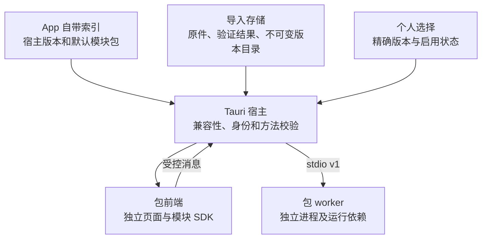

# OpenDesk 架构与边界

本文包含用户授权的本地版本化页签包。实现范围与运行证据分开，具体检查结果见 README 和验证记录。

OpenDesk 的应用标识为 `net.nimda.opendesk`。可执行文件、worker、构建目录及环境变量使用 OpenDesk / opendesk / OPENDESK 命名。默认配置与包选择归属该应用的数据目录，不自动迁入或删除旧应用数据；版本历史和历史验证记录保留原始身份及证据含义。

## 三层责任

| 层 | 责任 |
|---|---|
| Vue / TypeScript 宿主 | 工作区、分类设置、风格配色预览、通用宠物渲染、包列表、版本选择、错误展示、包页面容器 |
| Tauri / Rust 宿主 | 桌面与宠物窗口生命周期、设置存储、包校验/安装/选择、受控资源访问、命令边界和 worker 所有权 |
| 模块包 | 自己的独立前端、业务方法、可选 worker 与运行依赖 |

框架不能导入具体业务；构建组合选择源码模块并产出包，运行组合由已验证清单和宿主选择决定。塔防算法保留在原模块中，框架只管理其包及生命周期。

宿主 Vite 根入口为 `apps/composition/frontend`。组合层选择主界面或 `?surface=companion` 窗口并注入 `CompanionCatalog`；当前显式注册阿宝 `traveler-01` 和阿沐 `amu-01`，每只仅提供 `idle` 循环与 `still` 静态图。通用组件位于 `apps/framework/frontend/src/companions`，只认识契约，不导入角色目录。角色不是业务 `.ndpkg` 模块，来源与授权边界见 [宠物资源说明](companion-assets.md)。

## 版本事实与加载

`config/version.json` 保留宿主/core 与已有发布历史；包内 `manifest.json` 描述独立模块版本；App 索引说明本次默认随附内容；本机选择及成功激活状态说明用户实际使用版本。旧中央业务历史不能冒充当前包版本。

正式分发范围由 `config/distribution.json` 的 `bundledModules` / `publicModules` 决定，当前只含 `tower-assistant`。0.12.0 App 随附塔防助手 0.1.7；`test-lab` 是开发测试源码，生成包只用于本地 fixture，不进入 App 或独立 Release。运行时导入目录、已安装包和构建缓存都不能决定公开清单。源码归属、构建产物和发布范围分别检查。

模块前端由自己的 `frontend/index.html` 启动，使用相对路径资源。通过 `apps/framework/module-sdk` 的 `createModuleBridge()` 完成身份握手后访问 `bridge.host`。页面不直接导入 Tauri API，宿主核对当前包及其 manifest 业务方法。旧页面的消息不能被当作新版本结果。

每个带后台的包携带 `worker/module-worker.exe` 和 `_internal`。宿主只启动当前启用包的明确入口，不依赖源码目录、系统 Python 或任意用户执行路径。worker 身份通过构建时烘焙的 `module.identity` 确认；它与 `runtime.*` 都是管理协议，不列入业务 methods。

独立目录、消息来源校验和独立进程不是安全沙箱；本地代码包仍需来自用户信任的来源。框架不宣称任意恶意代码都被隔离。

## 导入和切换

导入先保存原件，再校验结构、身份、版本、API、平台、入口和数据 schema。失败项保留原件及错误，不执行代码或覆盖可用版本。

同 ID/版本/摘要是重复内容；同 ID/版本异摘要是冲突。同页签多个版本可以安装，只有当前启用版本运行。选择与激活成功分别表达，失败不能显示为切换成功。App 升级不能静默覆盖用户个人选择。

从新 App 随附清单中排除测试台不等于卸载用户先前导入的测试台。既有本机选择和导入数据继续独立保存，不复制到公开产物，也不因本次分发调整被自动删除。

## 状态、数据与生命周期

Rust 是框架设置和包选择的单一权威；前端缓存不是第二写入者。自带资源、导入原件、版本目录和业务数据分离。路径由宿主明确解析，不依赖启动 cwd。

设置仍为 schema 1，`uiStyle` 与宠物配置缺失时补充默认值。旧 `personalization.background` / `effects` 只作为兼容输入忽略，不参与渲染或执行；旧图片不读取、不删除。其他未知字段、无效枚举与宠物参数越界仍拒绝。前端维护可回滚的风格和配色草稿，浏览器预览只在当前会话生效。桌面宠物窗口使用已保存的设置，不能因为预览而绕过 Rust 的启用/模式检查。

代码版本与数据 schema 独立。当前不兼容数据 schema 直接拒绝，不提供静默迁移、快照恢复或覆盖式回退。选择旧代码不能删除升级后产生的新数据。塔防模块仍只读游戏文件，测试模块只回显消息，不引入业务数据库。

宿主只清理自己拥有的进程。失败、退出和超时不能当作成功；长任务、任意热卸载和任务恢复不因包机制而自动具备。WebView2 自己的缓存也不等于框架设置根。

## 静态风格与旧配置边界

OpenDesk 0.9.0 移除背景导入、背景显示、粒子和氛围调节，设置只保留风格与配色、宠物陪伴、窗口行为。`--import-wallpaper` 被明确拒绝。`core.personalization` 的历史 ID 与 0.8.0 验证记录继续保留；新版本将该能力标为已移除，不能从历史记录推断它仍可用。

六种风格保留；`glass` 显示为“深海透明”，采用深蓝黑半透明、青色细边、低圆角紧凑分区和顶部标签栏，建议搭配深色。存储 ID 与协议不变，呈现保持静态。`surfaceEffects` 继续作为 protocol 1 的可选兼容字段，当前宿主仅按风格生成固定材质与透明度描述，关闭表面动效；没有用户材质、浓度或氛围设置。消息不含图片 ID、路径、data URL 或图片字节。

模块 iframe 固定填满主内容区的剩余空间，内部 body 自行滚动；宿主不测量业务 DOM。设置变化不改变模块身份、版本选择或业务数据。

## 宠物窗口与所有权

OpenDesk 0.11.0 的两只角色来自用户第一段和第三段全身视频。阿宝保留 97 帧、24 FPS、约 4.041667 秒的完整站立—跑步—站立；阿沐默认取源帧 51–130（含）形成 80 帧、24 FPS、约 3.333333 秒循环，完整 145 帧、约 6.041667 秒另存于本机 `dist/companion-assets/amu-01/full-cycle.png`，不作为运行时重复资源。近景视频 (2) 弃用。框架保留空目录和缺失模型的显示守卫。

模型契约要求稳定 ID、名称与说明，`still` / `idle` 为必需资源，`walk` / `wave` / `sleep` 为可选独立资源。框架根据实际资源决定动作入口，缺少或重复使用同一路径的额外动作不显示；暂停始终使用 `still`，不将默认循环伪装成其他动作。

应用内组件在当前会话中管理拖动位置；桌面模式使用同一 Tauri 进程拥有的 `companion` WebView 窗口。窗口透明、无装饰、不占任务栏且不可直接拉伸，按保存的角色大小配置尺寸；是否置顶由设置决定。透明矩形不提供按像素自动鼠标穿透保证。

宠物窗口使用独立 capability，只能读取设置、报告自身就绪、查询可见状态、拖动和隐藏自己，以及订阅必要事件。它不能任意读写文件、保存设置或调用业务 worker。关闭该窗口转为隐藏，动画随隐藏暂停；主窗口收起到托盘时宠物可继续显示，整个 App 退出时一并销毁，没有另一个常驻宠物进程。

普通启动保留单实例约束，即使指定数据根也不会绕过；回调只唤起已有窗口，不处理 `--enable-companion`。使用该启用宠物选项前需退出已有实例；普通用户从资源管理器双击 `OpenDesk.exe` 启动。

`--smoke-test`、`--module-smoke`、`--companion-smoke` 仅在显式提供绝对 `OPENDESK_DATA_DIR` 时跳过单实例，允许与用户实例并存。变量缺失、空值、相对路径或重复/混用 smoke 模式时，启动阶段退出 2；调用方仍负责选择不与用户数据重叠的测试目录。WebView2 缓存仍使用默认应用缓存位置，不因此获得完整浏览器隔离。

`--companion-smoke` 使用真实设置、所选角色图片就绪与窗口事件，写入 `companion-smoke-result.json` 后退出；无资源或模型不存在时不能换用其他形象冒充成功。两个循环均采用原视频连续完整帧，未 AI 重画、插帧或变速；短循环默认选择可逆，不宣称严格无缝。来源与产物参数在各自的 `SOURCES.md` / `provenance.json` 记录。用户于 2026-10-22 进一步明确要求公开交付当前源码和 App，本次按该请求纳入处理后的角色；原视频仍不上传，不虚构第三方许可证。

## 构建与扩展

`scripts/module-pack.mjs` 负责独立 Vite 构建、worker 冻结、真实冻结 worker 验证和 ZIP 打包，`module-pack-archive.py` 只封装普通文件。摘要放在外部索引，不进入包内自引用。

`scripts/distribution.mjs` 统一校验公开模块白名单、测试模块排除和实际随附目录。`npm run build:module -- tower-assistant` 输出独立的 `dist/modules/tower-assistant/0.1.7/`；App 构建写入 `dist/app-build.json`，记录源码身份与产物清单。模块 smoke 从本地 fixture baseline 预置测试台，再验证版本切换，不要求把它放回正式随附清单。

`scripts/release-artifacts.mjs` 只在本地准备发布目录。App 暂存到 `dist/releases/app/0.12.0/`，塔防暂存到 `dist/releases/modules/tower-assistant/0.1.7/`；它核对干净提交、App 构建收据、正式模块来源和摘要，并拒绝重复版本目录。GitHub App 标签 `v0.12.0` 与模块标签 `modules/tower-assistant/v0.1.7` 分别对应独立 Release。下载索引为 [downloads.md](downloads.md)，暂存不意味着已上传或已可下载。

包构建固定 ZIP 元数据与 SOURCE_DATE_EPOCH，并按模块、SDK、worker、锁文件和工具链指纹复用已生成包，保留原来源身份；不承诺跨所有机器逐字节重建。构建事实与运行验证分别记录。

共享的静态风格、配色与模块公共表面样式纳入模块指纹。模块包不读取旧壁纸目录，也不包含角色目录或私人图片；宿主资源装配与业务包构建是不同责任。

范围是本地导入和版本选择，不包含在线市场、远程自动更新、签名信任链或数据降级系统。详细格式见[模块包契约](module-packages.md)。
