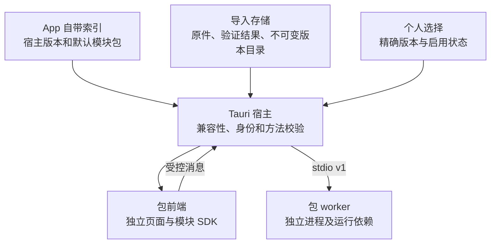

# NimdaDesk 架构与边界

本文包含用户授权的本地版本化页签包。实现范围与运行证据分开，具体检查结果见 README 和验证记录。

## 三层责任

| 层 | 责任 |
|---|---|
| Vue / TypeScript 宿主 | 工作区、设置、包列表、版本选择、错误展示、包页面容器 |
| Tauri / Rust 宿主 | 桌面生命周期、包校验/安装/选择、受控资源访问、命令边界和 worker 所有权 |
| 模块包 | 自己的独立前端、业务方法、可选 worker 与运行依赖 |

框架不能导入具体业务；构建组合选择源码模块并产出包，运行组合由已验证清单和宿主选择决定。塔防算法保留在原模块中，框架只管理其包及生命周期。

## 版本事实与加载

`config/version.json` 保留宿主/core 与已有发布历史；包内 `manifest.json` 描述独立模块版本；App 索引说明本次默认随附内容；本机选择及成功激活状态说明用户实际使用版本。旧中央业务历史不能冒充当前包版本。

模块前端由自己的 `frontend/index.html` 启动，使用相对路径资源。通过 `apps/framework/module-sdk` 的 `createModuleBridge()` 完成身份握手后访问 `bridge.host`。页面不直接导入 Tauri API，宿主核对当前包及其 manifest 业务方法。旧页面的消息不能被当作新版本结果。

每个带后台的包携带 `worker/module-worker.exe` 和 `_internal`。宿主只启动当前启用包的明确入口，不依赖源码目录、系统 Python 或任意用户执行路径。worker 身份通过构建时烘焙的 `module.identity` 确认；它与 `runtime.*` 都是管理协议，不列入业务 methods。

独立目录、消息来源校验和独立进程不是安全沙箱；本地代码包仍需来自用户信任的来源。框架不宣称任意恶意代码都被隔离。

## 导入和切换

导入先保存原件，再校验结构、身份、版本、API、平台、入口和数据 schema。失败项保留原件及错误，不执行代码或覆盖可用版本。

同 ID/版本/摘要是重复内容；同 ID/版本异摘要是冲突。同页签多个版本可以安装，只有当前启用版本运行。选择与激活成功分别表达，失败不能显示为切换成功。App 升级不能静默覆盖用户个人选择。

## 状态、数据与生命周期

Rust 是框架设置和包选择的单一权威；前端缓存不是第二写入者。自带资源、导入原件、版本目录和业务数据分离。路径由宿主明确解析，不依赖启动 cwd。

代码版本与数据 schema 独立。当前不兼容数据 schema 直接拒绝，不提供静默迁移、快照恢复或覆盖式回退。选择旧代码不能删除升级后产生的新数据。塔防模块仍只读游戏文件，测试模块只回显消息，不引入业务数据库。

宿主只清理自己拥有的进程。失败、退出和超时不能当作成功；长任务、任意热卸载和任务恢复不因包机制而自动具备。WebView2 自己的缓存也不等于框架设置根。

## 构建与扩展

`scripts/module-pack.mjs` 负责独立 Vite 构建、worker 冻结、真实冻结 worker 验证和 ZIP 打包，`module-pack-archive.py` 只封装普通文件。摘要放在外部索引，不进入包内自引用。

包构建固定 ZIP 元数据与 SOURCE_DATE_EPOCH，并按模块、SDK、worker、锁文件和工具链指纹复用已生成包，保留原来源身份；不承诺跨所有机器逐字节重建。构建事实与运行验证分别记录。

范围是本地导入和版本选择，不包含在线市场、远程自动更新、签名信任链或数据降级系统。详细格式见[模块包契约](module-packages.md)。
