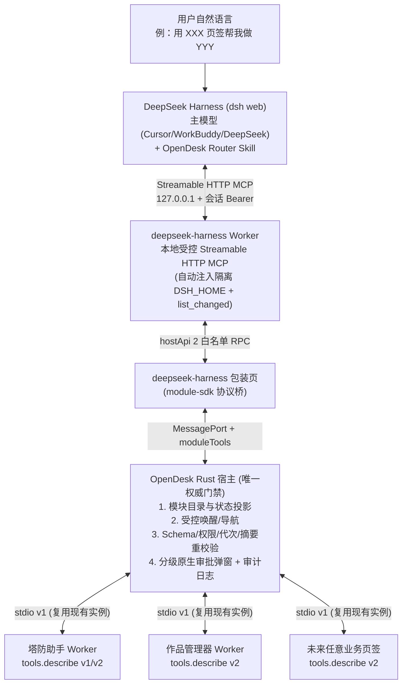

# DSH × OpenDesk 页签操控链路统一规划

本文档规划如何打通 **DeepSeek Harness (`dsh`)** 与 **OpenDesk** 的跨页签协作链路，使未来用户可以在 DSH 对话中直接通过自然语言驱动已安装的 OpenDesk 页签功能（例如：「帮我打开塔防助手查看当前收益统计」「用作品管理器检索某个作品并打开详情」「在 XXX 页签里执行某个受控操作」），同时严格遵守 OpenDesk 的架构隔离、单权威状态与分级人工审批边界（见 [架构与边界](architecture.md) 与 [工程基本原则](principles.md)）。

> **文档状态声明**：本文档明确区分「已实现并验证」与「后续扩展」；阶段 1（零配置 MCP 自动注入与 `list_changed` SSE）、阶段 2（宿主 `moduleToolsV2` 页签目录发现与受控唤醒）、阶段 3（`tools.describe` `contractVersion: 2` 有界参数校验与写操作逐次原生审批）及阶段 4（DSH 隔离 Router Skill + 塔防助手 `0.10.3` 首批 v2 参数化只读工具示范）已完成代码实现与自动化/实机链路验证；其余业务页签（如作品管理器等）后续按各自需求独立接入。

---

## 1. 当前已实现能力总览（阶段 1–4 核心链路已贯通）

当前仓库已完整打通从 DSH 到 OpenDesk 宿主与目标业务页签的受控协同链路：

1. **独立 `hostApi: 2` / `webApp: true` 页签**：`deepseek-harness`（源码版本 `0.4.1`）通过包内 Python 监督 Worker 与本地 HTTP/WebSocket 反向代理承载原生 `dsh web`，支持托管模式、外部模式及本地源码开发工作流（`pnpm install`、`build:artifacts`、`dev:web`）。
2. **阶段 1 — 零配置 MCP 自动注入与动态推送**：
   - `start_webapp()` 立即启动 `127.0.0.1:<随机端口>/mcp` 的标准 Streamable HTTP MCP 端点（精确 `Host` + 会话随机 `Bearer` + `GET /mcp` SSE `notifications/tools/list_changed` 推送）；
   - 托管隔离模式下自动生成 `<data>/opendesk-bridge.patch.yml`（令牌仅经 `OPENDESK_MCP_TOKEN` 子进程环境变量传递，不落盘明文）并通过 `--patch` 挂载 `@deepseek-ai/dsh-mcp-client`（`serverName: opendesk`，工具前缀 `mcp__opendesk__*`）。
3. **阶段 2 — 宿主 `moduleToolsV2: 1` 页签发现与受控唤醒**（保留 `moduleTools: 1` 100% 兼容旧包）：
   - 新增仅限 `main` 窗口的 Tauri 命令 `modules_tools_list_modules` 与 `modules_tools_open_module`；
   - 经 MCP 暴露 `opendesk_list_modules`（枚举已启用页签状态）与 `opendesk_open_module(moduleId, focus?)`（未打开时弹出原生确认框，经用户同意后由 `App.vue` 挂载目标 `<PackageFrame>` 并等待就绪后返回工具列表，默认后台静默唤醒不打断对话）。
4. **阶段 3 — `tools.describe` `contractVersion: 2` 参数化校验与分级审批**：
   - 宿主以 `{"maxContractVersion": 2}` 向目标页签协商（旧包拒绝时自动回落 `{}` 兼容 v1）；
   - Rust 宿主边界严格校验 v2 `inputSchema`（有界扁平对象、`additionalProperties: false`、禁止执行类属性名与嵌套对象）与运行时参数（上限 16 KiB、范围/长度/枚举/无控制字符/无 `..` 路径遍历）；
   - 分级审批：`read` / `ui-navigate` 沿用会话内批量原生确认，**`write` 每次调用强制触发 Rust 原生警告弹窗展示目标模块身份与参数 JSON 摘要**，拒绝直接放行并记录审计日志。
5. **阶段 4 — DSH Router Skill 与首批业务页签示范**：
   - 托管隔离 `DSH_HOME/skills/opendesk-workbench/SKILL.md` 自动内置 OpenDesk 跨页签路由决策协议；
   - `tower-assistant`（源码版本 `0.10.3`）已升级支持 `tools.describe` v1/v2 协商并新增参数化只读工具 `runtime_summary_filtered`（`tower.ai.summary.filtered`）。
6. **本地源码仓双 ACP 模型接入**（位于独立平级仓库 `D:\MyWorkspace\deepseek-harness`，不混入 OpenDesk Git）：
   - `@deepseek-ai/dsh-llm-cursor-cli`：`Cursor CLI (ACP)` 常驻主模型（45 条含 `1M`/`500K`/`300K`/`272K` 上下文选项的模型条目与推理档位）+ `subagent_cursor`；
   - `@deepseek-ai/dsh-llm-workbuddy-acp`：`WorkBuddy (ACP)` 常驻主模型（30 条模型与思考档位）+ `subagent_workbuddy`。

### 后续演进项（未实现，按需推进）

- 其余独立业务页签（如 `nimda-workspace` 作品管理器等）按各自具体需求自主接入 `tools.describe` v2；
- 在完整桌面 WebView2 窗口中对新版本宿主与 `0.4.0` 页签做真实人工弹窗点击与多页签交互验收；
- 需要正式发布新宿主版本时通过 `npm run version:prepare` 提升宿主版本号并构建发布。

---

## 2. 目标统一链路架构



### 核心设计原则（不可突破的架构红线）

1. **宿主保持通用、轻薄且业务无关**：Rust 宿主只理解通用契约（模块 ID、版本、摘要、代次、工具描述符、JSON Schema、风险级别），**绝不内置任何具体业务页签的命令逻辑或私有数据结构**。
2. **单一权威与单实例所有权**：目标页签只能由 OpenDesk 宿主激活与管理，绝不因为一次工具调用而私自拉起第二份 worker，也不允许 DSH 直接连接其他模块的内部端口或直接读写 `modules/<id>/data`。
3. **禁止跨 iframe DOM 操控**：一切“操作某页签”都走**声明式命名工具 + 受控导航契约**，绝不向其他页签注入脚本、跨 DOM 查询或模拟键鼠点击。
4. **分级审批与最小权限**：
   - 只读查询可按会话批量授权；
   - **任何有副作用的写操作必须走宿主逐次原生弹窗确认（Human-in-the-loop）**，由宿主展示目标模块身份与实际参数摘要，用户点击确认后才转发执行。
5. **契约复用**：OpenDesk 宿主演进的 `tools.describe` v2 契约同时服务于 `deepseek-harness`、`ai-workbench` 及未来任何 AI/自动化页签，业务页签只需声明一次工具契约即可被所有受控调用方复用。

---

## 3. 分阶段演进路线

### 阶段 1：零配置 MCP 自动接通（纯插件侧，无宿主变更）

- **目标**：打开 `deepseek-harness` 页签并在面板授权后，DSH 立刻自带 `opendesk-bridge` MCP 工具，无需用户手工复制粘贴 URL 和 Bearer Token。
- **技术方案**：
  1. 在 `deepseek-harness` Worker 托管启动 `dsh web` 时，自动在隔离目录 `<data>/dsh-home/` 下生成/注入一份独立的 MCP overlay 配置（指向本轮会话的 `http://127.0.0.1:<mcp_port>/mcp` 与临时 Bearer Token，仅写进插件隔离 `DSH_HOME`，绝不改写用户本机 `~/.dsh`）；
  2. 为 `mcp_bridge.py` 补全 `notifications/tools/list_changed` 与可选 SSE 推送，当用户增删已授权工具时通知 DSH 刷新工具目录；
  3. 仅对托管隔离模式自动注入；外部模式或复用 `~/.dsh` 时仍保留一键复制配置 JSON，尊重用户已有环境。
- **验收点**：打开塔防助手 → 在 DSH 页签勾选授权 → 直接在 DSH 聊天中询问当前统计即可命中 MCP 工具，零手动粘贴。

### 阶段 2：页签目录发现与受控唤醒/导航（OpenDesk 宿主 `moduleTools` v2-a）

- **目标**：解决「我要用 XXX 页签，但它现在还没打开」的问题，让 DSH 能先查清有哪些页签、经确认后由宿主打开/切换过去。
- **宿主新增通用元能力**（均经 `module-sdk` `bridge.host.tools` 与 Rust 边界严格校验）：
  1. `host.modules.list`（只读元数据）：返回当前已安装且已启用的模块列表：`{ moduleId, label, version, opened, supportsTools, toolCount }`（不暴露磁盘路径、token 或禁用/失败包的敏感详情）；
  2. `host.modules.open`（受控激活）：参数 `{ moduleId, focus?: boolean }`，校验目标模块已安装、已选择、兼容且有效；经用户授权后复用主界面标准打开逻辑激活该页签并等待其就绪，返回当前打开代次（`generation`）；
  3. `host.modules.focus`（低风险导航）：在已打开页签间切换焦点，便于用户亲眼看到即将操作的目标页签状态。
- **MCP 映射**：在 `deepseek-harness` 的 MCP Server 中导出两个通用元工具：`opendesk_list_modules` 与 `opendesk_open_module`。

### 阶段 3：参数化工具与分级写操作契约（`tools.describe` `contractVersion: 2`）

- **目标**：让业务页签能够安全导出“带参数查询”“视图导航”与“受控写操作”，满足「在 XXX 页签里做某件事」的真实需求。
- **契约升级（向后兼容 v1）**：
  - 保留 `contractVersion: 1`（无参只读）完全兼容；
  - 新增 `contractVersion: 2` 工具描述符字段：

```json
{
  "contractVersion": 2,
  "name": "search_works",
  "method": "media.search",
  "title": "检索作品条目",
  "description": "按关键词和标签在当前已打开的作品库中只读检索匹配条目。",
  "access": "read",
  "confirm": "session",
  "inputSchema": {
    "type": "object",
    "properties": {
      "query": { "type": "string", "maxLength": 120 },
      "limit": { "type": "integer", "minimum": 1, "maximum": 50 }
    },
    "required": ["query"],
    "additionalProperties": false
  }
}
```

- **三级访问与审批矩阵（Rust 宿主强制执行）**：

| `access` | 语义 | 参数边界（Rust 复验） | 审批策略 |
| --- | --- | --- | --- |
| `read` | 只读查询与计算 | 有界标量/数组/枚举，禁止控制字符与路径遍历；JSON 载荷 ≤ 16 KiB | 会话内批量原生弹窗授权一次 |
| `ui-navigate` | 切换页签子视图、聚焦条目、打开受控第二视图 | 仅允许声明的枚举视图名与有限 ID | 会话内授权或单次确认 |
| `write` | 创建/修改业务数据、提交计划、触发外部可控操作 | 同上 + 禁止任何任意 shell/命令/任意绝对路径参数 | **强制逐次原生弹窗审批**（展示目标模块、版本、摘要、操作标题与完整参数摘要） |

- **协议与安全守卫**：
  - 工具结果上限保持 64 KiB，统一附带 `{ moduleId, version, generation, executedAt }` 来源元数据；
  - `scripts/check-boundaries.mjs` 静态检查拒绝 `tools.describe` 映射到 `runtime.*`、`module.*` 或通用执行类方法名；
  - 宿主审计日志（`framework.jsonl`）记录每一次跨页签调用的关联 ID、调用方模块、目标模块/版本、工具名、风险级别、审批结论、耗时与错误码（不记录敏感令牌或完整私人提示词）。

### 阶段 4：DSH 侧意图路由 Skill 与业务页签渐进接入

- **DSH Router Skill（托管隔离 `DSH_HOME` 内置）**：
  为 DSH 提供一份简洁的内置 Skill，约定当用户提出「我要用 XXX 页签做 YYY」时的标准执行协议：
  1. **发现**：先调 `opendesk_list_modules` 确认目标页签名称、是否已启用、是否已打开；
  2. **唤醒**：目标未打开时说明原因并调用 `opendesk_open_module`；打开后再读取目标最新工具列表；
  3. **只读探查**：优先调用 `read` 类工具获取当前权威快照，避免凭空猜测状态；
  4. **受控执行**：涉及 `write` 工具时先向用户简述将要提交的参数，再发起工具调用等待 OpenDesk 宿主原生审批框结果；用户拒绝则立即停止，不重复弹窗骚扰；
  5. **结果复核**：执行完毕后回传目标页签返回的结构化结果或重新读取只读快照，不伪造成功。
- **各业务页签未来按需接入方向（均由各自模块按实际需求独立演进，不强制捆绑）**：
  - **`tower-assistant`（塔防助手）**：已有 v1 无参只读统计摘要；后续可按需增加参数化角色/阶段查询、渡劫方案只读试算与聚焦对应视图；
  - **`nimda-workspace`（作品管理器）**：后续可按需导出只读检索、作品详情查询、定位到指定作品视图等命名工具；
  - **其他独立页签**：只需在各自 `manifest.methods` 注册 `tools.describe`（v1 或 v2）与受控命名方法，无需修改 `deepseek-harness` 或 OpenDesk 框架代码即可被自然语言发现与操控。

---

## 4. 实施优先级与风险控制

| 优先级 | 阶段 | 改动范围 | 风险等级 | 依赖前提 |
| --- | --- | --- | --- | --- |
| P0（下一步推荐） | 阶段 1：零配置 MCP 自动注入 + `list_changed` | 仅 `plugins/deepseek-harness` | 低 | 无需改宿主版本，可直接发插件 `0.4.0` |
| P1 | 阶段 2：页签目录发现与受控唤醒/导航 | 宿主 `module_packages` + `module-sdk` + `deepseek-harness` | 中 | 需推进宿主新 minor 版本（`version:prepare`） |
| P2 | 阶段 3：`tools.describe` v2（参数化 + `write` 逐次审批） | 宿主 Rust 校验与审批 UI + `module-sdk` + `check-boundaries` | 中高 | 需完整的 Rust/前端契约测试与拒绝路径测试 |
| P3 | 阶段 4：DSH Router Skill + 首批业务页签接入 | DSH 隔离 Skill + 目标业务页签独立升版 | 低 | 依赖阶段 2/3 契约稳定 |
